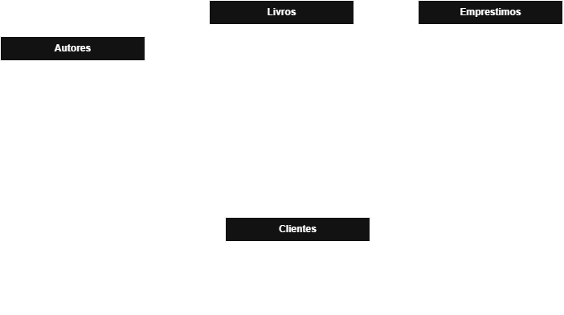

# BookStore Manager CLI

Aplicação de gerenciamento de uma livraria desenvolvida em **TypeScript**, executada pelo terminal. O projeto permite administrar autores, livros, clientes e empréstimos, aplicando conceitos de orientação a objetos, arquitetura em camadas, validação de regras de negócio e testes automatizados.

## Funcionalidades

### Autores
- Cadastrar autores.
- Listar autores.
- Consultar autor por ID.
- Atualizar dados de autores.
- Excluir autores, respeitando as regras de relacionamento com livros.

### Livros
- Cadastrar livros vinculados a autores.
- Listar livros.
- Consultar livro por ID.
- Atualizar informações e quantidades do estoque.
- Excluir livros, respeitando o histórico de empréstimos.

### Clientes
- Cadastrar clientes com nome e e-mail.
- Listar clientes.
- Consultar cliente por ID.
- Atualizar dados cadastrais.
- Excluir clientes, respeitando as regras de empréstimos.
- Validar e-mails duplicados sem diferenciar letras maiúsculas e minúsculas.

### Empréstimos
- Registrar empréstimos de livros para clientes.
- Registrar devoluções.
- Listar todos os empréstimos.
- Consultar empréstimos por ID.
- Listar empréstimos ativos.
- Listar empréstimos devolvidos.
- Controlar a quantidade disponível de livros conforme os empréstimos e devoluções.

## Tecnologias utilizadas

- **Node.js** — ambiente de execução JavaScript.
- **TypeScript** — tipagem estática e desenvolvimento orientado a objetos.
- **tsx** — execução de arquivos TypeScript durante o desenvolvimento.
- **Node.js Test Runner** — execução dos testes automatizados.
- **PostgreSQL** — tecnologia utilizada na modelagem do banco de dados.

## Arquitetura do projeto

O projeto utiliza uma arquitetura em camadas, separando responsabilidades para facilitar manutenção, testes e evolução.

```text
BookStore-Manager-CLI/
│
├── database/
│   ├── DER.png
│   ├── modelagem.md
│   └── script.sql
│
├── src/
│   ├── controllers/
│   ├── data/
│   │   └── seed.ts
│   ├── menus/
│   ├── models/
│   ├── repositories/
│   ├── services/
│   ├── utils/
│   └── main.ts
│
├── tests/
│   └── services/
│
├── .gitignore
├── package.json
├── package-lock.json
├── tsconfig.json
└── README.md
```

### Responsabilidades das camadas

| Camada | Responsabilidade |
|---|---|
| `models` | Representação das entidades do sistema. |
| `repositories` | Gerenciamento e acesso aos dados em memória. |
| `services` | Implementação das regras de negócio e validações. |
| `controllers` | Comunicação entre a interface e os serviços. |
| `menus` | Interface interativa pelo terminal. |
| `utils` | Recursos auxiliares, como leitura de entradas. |
| `data` | Inicialização dos dados de demonstração. |
| `tests` | Testes automatizados dos serviços. |

A inicialização da aplicação é centralizada em `src/main.ts`, responsável por instanciar as dependências e conectá-las por meio de injeção de dependência.

## Pré-requisitos

Para executar o projeto, é necessário ter instalado:

- Node.js.
- npm (incluído na instalação do Node.js).
- Git.

Não é necessário instalar ou configurar PostgreSQL para executar a versão atual da aplicação.

## Instalação

Clone o repositório:

```bash
git clone https://github.com/cristiermc/bookstore-manager-cli.git
```

Entre na pasta do projeto:

```bash
cd bookstore-manager-cli
```

Instale as dependências:

```bash
npm install
```

## Executando a aplicação

Para executar diretamente os arquivos TypeScript durante o desenvolvimento:

```bash
npm run dev
```

A aplicação apresentará o menu principal:

```text
==================================
       BOOKSTORE MANAGER CLI
==================================
1. Gerenciar autores
2. Gerenciar livros
3. Gerenciar clientes
4. Gerenciar empréstimos
0. Sair
==================================
Escolha uma opção:
```

Selecione a opção desejada e siga as instruções apresentadas no terminal.

## Compilação e execução

Para compilar o projeto:

```bash
npm run build
```

Os arquivos JavaScript compilados serão gerados na pasta `dist/`.

Para executar a versão compilada:

```bash
npm start
```

## Testes automatizados

O projeto utiliza o test runner nativo do Node.js, com execução dos arquivos TypeScript por meio do `tsx`.

Para executar toda a suíte de testes:

```bash
npm test
```

Os testes cobrem as regras de negócio dos serviços de autores, livros, clientes e empréstimos, incluindo validações, operações CRUD e regras relacionadas ao controle de empréstimos e devoluções.

## Banco de dados

O projeto inclui a modelagem de um banco de dados relacional PostgreSQL, disponível na pasta `database/`:

- `DER.png` — Diagrama Entidade-Relacionamento.
- `modelagem.md` — documentação da modelagem e das decisões técnicas.
- `script.sql` — script de criação das tabelas, relacionamentos, restrições e índices.

### Diagrama Entidade-Relacionamento (DER)

O diagrama representa as quatro entidades do modelo relacional — Autores, Livros, Clientes e Empréstimos —, seus atributos, chaves primárias (PK), chaves estrangeiras (FK) e os relacionamentos entre elas.



**Importante:** a versão atual da aplicação utiliza repositórios em memória, inicializados com dados de demonstração por meio de `src/data/seed.ts`. A integração dos repositórios com o PostgreSQL ainda não foi implementada.

Consequentemente, os dados cadastrados ou modificados durante a execução não são persistidos após o encerramento da aplicação. O script SQL representa a estrutura planejada para o banco de dados e pode ser analisado ou executado separadamente em um ambiente PostgreSQL.

## Desenvolvimento e versionamento

O desenvolvimento utiliza Git e GitHub, seguindo um fluxo baseado em GitFlow:

- `main`: versão estável do projeto.
- `develop`: branch de integração.
- `feat/*`: branches destinadas à implementação de funcionalidades.
- `test/*`: branches destinadas aos testes.
- `docs/*`: branches destinadas à documentação.

As funcionalidades são desenvolvidas em branches específicas, revisadas por meio de Pull Requests e integradas à branch `develop`.

## Objetivos de aprendizagem

Este projeto foi desenvolvido como parte do percurso de aprendizagem em desenvolvimento Back-end, aplicando conceitos como:

- JavaScript e TypeScript.
- Programação orientada a objetos.
- Separação de responsabilidades.
- Arquitetura em camadas.
- Interfaces e injeção de dependência.
- Operações assíncronas.
- Tratamento de erros e validações.
- Testes automatizados.
- Modelagem relacional e SQL.
- Versionamento com Git e GitHub.

## Autor

**Cristier Machado Cittadin**

GitHub: [@cristiermc](https://github.com/cristiermc)

Repositório: [bookstore-manager-cli](https://github.com/cristiermc/bookstore-manager-cli)
